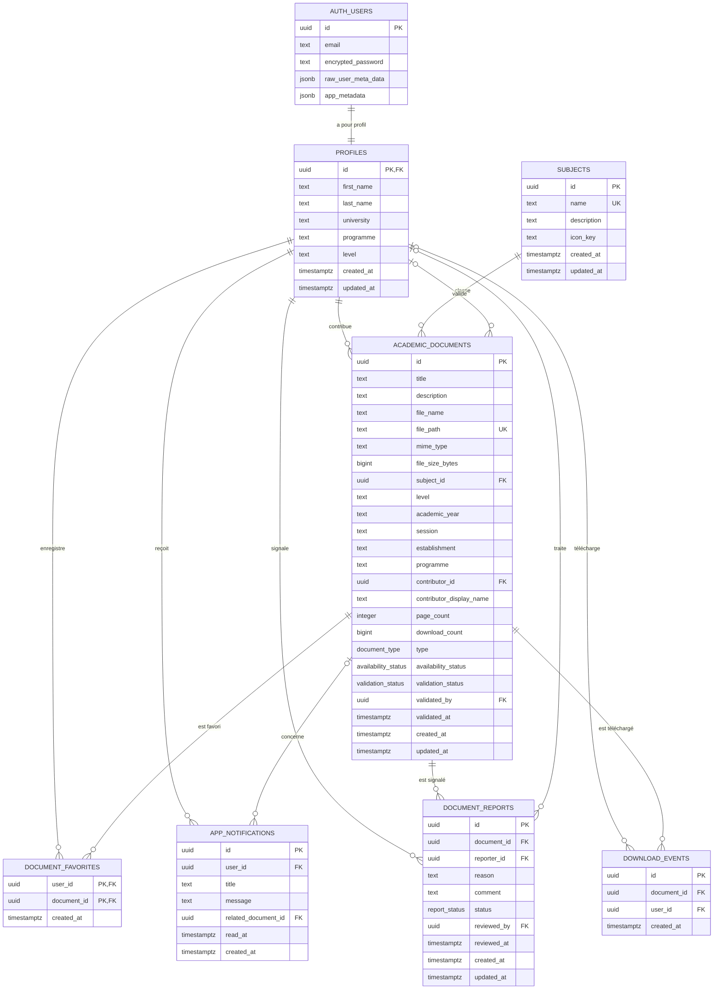

# Schéma de la base de données

Base cible : PostgreSQL via Supabase. La migration initiale se trouve dans [`supabase/migrations/20261120061500_initial_schema.sql`](./supabase/migrations/20261120061500_initial_schema.sql).

## Diagramme relationnel

`AUTH_USERS` est gérée par Supabase Auth et n’est pas créée dans le schéma `public`. `profiles.id` référence `auth.users.id`; l’adresse e-mail et le mot de passe restent gérés par Auth. Les mots de passe ne doivent jamais être copiés dans `profiles`.

## Tables

| Table | Rôle |
|---|---|
| `profiles` | Profil académique lié à un compte Supabase Auth. Créé automatiquement à l’inscription. |
| `subjects` | Catalogue des matières. Quatre matières du catalogue actuel sont insérées sans doublons par la migration. |
| `academic_documents` | Métadonnées, statut de modération et référence Storage d’un document. |
| `document_favorites` | Association utilisateur-document, avec unicité par paire. |
| `app_notifications` | Notifications et état de lecture par utilisateur. |
| `document_reports` | Motifs de signalement et suivi de modération. |
| `download_events` | Historique des téléchargements authentifiés ; un trigger maintient `download_count`. |

Le nombre de documents d’une matière se calcule à partir de `academic_documents.subject_id` ; il n’est pas stocké en double. `contributor_display_name` conserve le nom public affiché au moment du dépôt, sans rendre tout le profil lisible. `isFavorite` se calcule avec la table d’association.

## Énumérations

| Type PostgreSQL | Valeurs |
|---|---|
| `document_type` | `exam`, `answer_key`, `assignment`, `course` |
| `validation_status` | `pending`, `verified`, `disputed`, `rejected` |
| `availability_status` | `available`, `unavailable` |
| `report_status` | `open`, `reviewing`, `resolved`, `dismissed` |

Correspondance avec les libellés de l’application :

| Base | Interface |
|---|---|
| `exam` | Examen |
| `answer_key` | Corrigé |
| `assignment` | Devoir |
| `course` | Cours |
| `pending` / `verified` / `disputed` / `rejected` | En attente / Vérifié / Contesté / Rejeté |
| `available` / `unavailable` | Disponible / Indisponible |

Les motifs de signalement acceptés sont `incorrect_document`, `unreadable_content`, `wrong_format`, `wrong_answer_key` et `other`.

## Relations et contraintes principales

- Un compte Auth possède un profil ; la suppression du compte supprime son profil et ses données utilisateur associées.
- Un document appartient à une matière et à un contributeur. La suppression d’une matière référencée est refusée.
- La taille des fichiers est limitée à 10 Mio. Le chemin de fichier est unique.
- Un document vérifié doit avoir une date `validated_at`.
- Un favori est unique par utilisateur et par document.
- Un signalement et un téléchargement sont liés à un document.
- `download_count` est incrémenté par la base à chaque insertion autorisée dans `download_events`.

## Sécurité Supabase

La migration active RLS sur toutes les tables `public` :

- matières lisibles sans connexion ; modifications réservées à un rôle admin ;
- documents vérifiés lisibles ; les contributeurs voient aussi leurs propres documents non publiés ;
- utilisateurs limités à leurs favoris, notifications, signalements et téléchargements ;
- les utilisateurs peuvent uniquement modifier `read_at` sur leurs notifications ;
- dépôt, édition, modération et suppression de documents encadrés par le propriétaire et l’état de validation ;
- rôle admin lu depuis `app_metadata.role` du JWT, non modifiable par l’utilisateur depuis ses métadonnées publiques ;
- bucket Storage `academic-documents` non public, limité à 10 Mio ; les chemins d’envoi doivent commencer par l’UUID du compte (`<auth.uid()>/<nom-unique>`).

Les accès au stockage sont filtrés par des politiques RLS. Un fichier n’est lisible que si son document est vérifié, s’il appartient à l’utilisateur connecté ou si celui-ci est admin. Le client ne doit jamais embarquer de clé `service_role`.

## Index

Les index couvrent le titre, la matière, le contributeur, l’état de publication, les notifications à afficher par date, les signalements à traiter et l’historique des téléchargements.

## À relier côté application

Le catalogue et le `AppStore` actuels sont locaux et contiennent des données de démonstration. La migration prépare le schéma Supabase mais ne remplace pas ces données et ne modifie pas les écrans. L’intégration devra notamment :

1. utiliser Supabase Auth à la place de l’authentification locale simulée ;
2. charger les matières et documents depuis PostgreSQL et convertir les identifiants en UUID ;
3. téléverser les fichiers vers le bucket, puis créer la ligne `academic_documents` avec le même `file_path` ;
4. enregistrer les favoris, notifications, signalements et téléchargements dans leurs tables ;
5. traduire les valeurs d’énumération de la base vers les libellés français affichés.
